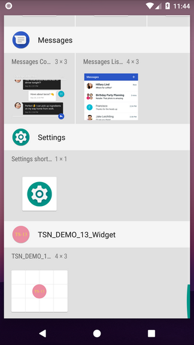
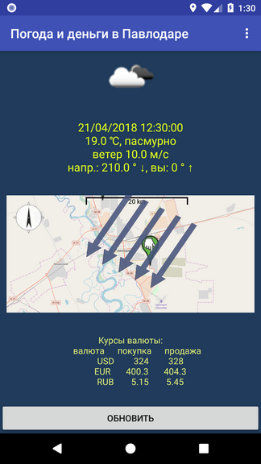
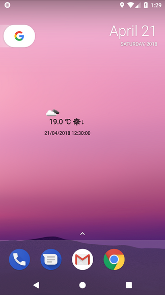

# TSN_ANDROID_05-WidOSM
**Виджет**

---

**Работа с картами OpenStreetMap**

*Нажатие на иконку погоды в виджете принудительно обновляет его, а нажатие на сам виджет открывает окно программы. Автообновление виждетов: 30 минут.*

*Необходимые рзарешения: интренет, доступ к хранилищу (для загрузки карты), определение местоположения.*

